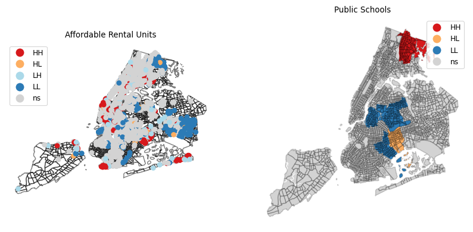
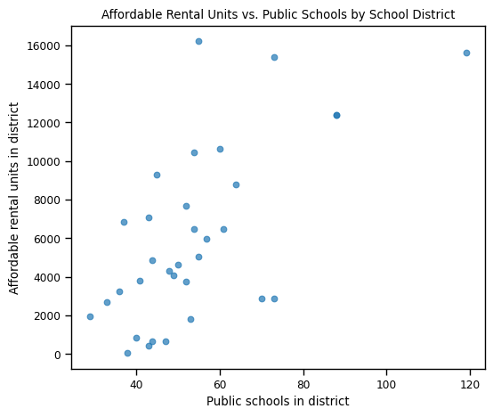

# Is Affordable Housing in NYC Located Near Public Schools?

A spatial analysis of New York City affordable housing and public schools in Python (GeoPandas, PySAL).

Final project for CRP 3850 at Cornell University (June 2024). The statistical tests in the second half were added in October 2026 to test the original conclusion directly.

**Tools:** Python, GeoPandas, PySAL (libpysal, esda, splot), SciPy, Matplotlib, Jupyter

---

## Key finding

**Districts with more public schools also have more affordable rental units, even with district size held constant** (partial Spearman ρ = 0.770, p < 0.001, 32 school districts).

This reverses the original conclusion. Comparing the two cluster maps by eye, the 2024 poster concluded that affordable housing "seems to not be related" to school locations. Testing the relationship directly showed that it is.

---

## Results

| Question | Result |
|---|---|
| Is affordable housing spatially clustered? | Yes: global Moran's I = 0.351, p = 0.001 |
| Are public schools spatially clustered? | Yes: global Moran's I = 0.203, p = 0.019 |
| Do districts with more schools have more affordable rental units? | Yes: Spearman ρ = 0.601, p < 0.001 (33 district shapes; see note below) |
| Does it hold with district size held constant? | Yes: partial Spearman ρ = 0.770, p < 0.001 (32 districts) |

---

## Checks along the way

- **A district counted twice.** The school district file stores one district as two shapes, giving 33 rows for 32 districts. The size-controlled test merges them; the first test ran before that fix.
- **A misleading ratio.** Comparing densities (schools per km² vs. units per km²) gave ρ = 0.923, but dividing both measures by the same area creates correlation on its own, and district sizes vary roughly tenfold. A partial correlation that holds area constant is the cleaner control.

## Limitations

- **Population is the likely common cause.** Both schools and affordable housing follow where people live. The analysis shows co-location at the district level, not that affordable housing is deliberately built near schools.
- **Coarse units.** Schools are counted per district (32 districts), so the test cannot see access within a district.
- **Data vintages differ.** The housing data covers 2014 to the present, the school locations are from 2019, and the tracts are from 2020.

**Next steps:** control for population, and measure access directly, for example the distance from each affordable housing building to its nearest public school.

---

## Methods

1. **Data:** loaded four NYC Open Data sets and converted them to a common coordinate system (EPSG:4326).
2. **Geocoding:** built point geometries for affordable housing projects from their latitude and longitude.
3. **School counts:** counted public schools per school district and joined the counts to the district shapes.
4. **Spatial weights:** k-nearest-neighbor weights (k = 4) for housing points and for districts.
5. **Clustering:** local Moran's I (LISA) cluster maps at p < 0.05, plus global Moran's I for each layer.
6. **Relationship test:** spatial join of housing buildings to school districts, totaling affordable rental units per district, then Spearman and Pearson correlations with school counts, and a rank-based partial correlation holding district area constant.

---

## Repository contents

| Folder | Contents |
|---|---|
| `notebooks/` | `housing_school_access.ipynb`: the full analysis, with outputs |
| `images/` | Maps and charts exported from the notebook |
| `poster/` | The original June 2024 poster and presentation (PDF) |

## Data

All data is from [NYC Open Data](https://opendata.cityofnewyork.us/) and is not included in this repository. Download these files into the notebook's folder:

- [Affordable Housing Production by Building](https://data.cityofnewyork.us/Housing-Development/Affordable-Housing-Production-by-Building/hg8x-zxpr/about_data): save as `Affordable_Housing_Production.csv`
- [2020 Census Tracts](https://data.cityofnewyork.us/City-Government/2000-Census-Tracts/ysjj-vb9j): save as `2020 Census Tracts.zip`
- [School Districts](https://data.cityofnewyork.us/Education/School-Districts/r8nu-ymqj): save as `School Districts.zip`
- [Public School Locations](https://data.cityofnewyork.us/Education/School-Point-Locations/jfju-ynrr/about_data): save as `Public_School_Locations.zip`
